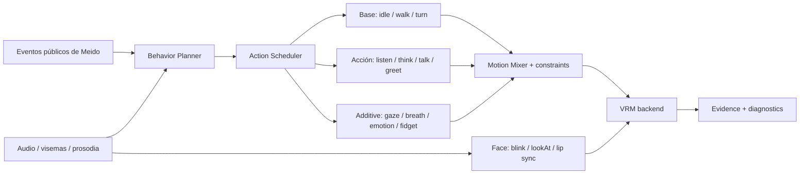

# Estudio: avatar reactivo con movimiento natural en RigM

**Fecha:** 2026-10-30  
**Alcance:** evaluar cómo dar a Meido una actuación reactiva convincente y qué arquitectura permite ofrecer avatares 2D y 3D en RigM.  
**Resultado:** la animación procedural actual sirve como prototipo de estados y controles, pero no como locomoción ni actuación final. Se implementó un backend 3D opcional VRM/glTF y se conserva el backend 2D. El backend es ejecutable, aunque la calidad final depende de un modelo preparado y clips de actuación revisados.

## Resumen ejecutivo

Una persona no actúa como una secuencia de poses aisladas. Respira, desplaza el peso, mira a alguien y luego aparta la vista, anticipa una acción, mueve el cuerpo principal y deja que pelo/ropa sigan con retraso. Al hablar, gestos, cabeza, expresión y voz guardan relación temporal, pero no repiten un ciclo fijo. Por eso, subir amplitudes de senos o mover todo el PNG de un lado al otro produce más actividad visual, pero no la causa ni la coordinación que el ojo interpreta como movimiento natural.

La investigación sobre gestos conversacionales trata la generación realista como un problema multimodal aún abierto: el movimiento se relaciona con voz, texto, emoción y estilo individual. Incluso en evaluaciones grandes, los movimientos sintéticos pueden parecer humanos y, a la vez, no corresponder bien al contenido concreto del habla. La solución práctica para RigM no es pedirle a un modelo que invente cada fotograma, sino mezclar clips diseñados/capturados, controles proceduralmente acotados y señales explícitas del agente; añadir generación neuronal sólo como adaptador opcional y después de tener una base verificable. [BEAT](https://arxiv.org/abs/2203.05297) · [GENEA Challenge 2022](https://arxiv.org/abs/2208.10441).

**Recomendación:** mantener el rig 2D existente y crear una segunda clase de recurso, `avatar_3d`, basada en VRM 1.0/glTF. RigM seguirá siendo el dueño del proyecto, sus eventos y la validación; un visor 3D opcional reproducirá clips y mezclará mirada, expresiones, sincronía de voz y física secundaria. Para Meido, primero hay que preparar un modelo 3D estilizado a partir de referencias y aprobar su semejanza. Una sola imagen frontal no contiene la geometría ni el diseño de la espalda y los perfiles.

## 1. Diagnóstico del caso actual

RigM es un editor raster PyQt6 con mallas 2D y transformaciones calculadas en Python/Pillow/OpenCV. No tiene todavía un renderizador 3D ni una representación de malla humanoide glTF. El proyecto actual de Meido valida con 16 articulaciones, 15 huesos, 20 capas, 19 mallas, 3 clips y ninguna expresión guardada. La mayor parte del atuendo se concentra en una pieza `topwear` y otra `legwear`; separar el rig en hombro/codo/cadera/rodilla no crea automáticamente esas piezas anatómicas ni repara las zonas ocultas.

Consecuencias visibles:

- Rotar el torso y las piernas mueve mallas 2D extraídas de una pose frontal; al separarse las piezas salen huecos, estiramientos o costuras.
- Hay articulaciones de cadera, rodilla y tobillo, pero falta la geometría segmentada que permitiría flexionar cada parte con volumen y mantener el contacto del pie.
- La placa de fondo aún conserva restos de la silueta; un desplazamiento espacial del PNG completo desplaza también el fondo y no equivale a caminar en un escenario fijo.
- La boca se aproxima con un óvalo procedural; no existe una hoja de formas fonéticas aprobadas. Tampoco hay formas clave de manos/dedos para hablar, pensar o señalar.
- `BehaviorRuntime` selecciona estados y añade pequeñas oscilaciones. Le faltan una biblioteca de acciones con anticipación/seguimiento, control de pies, movimiento raíz, objetivos de interacción y revisión del ciclo completo.

Esto confirma que el problema observado no se arregla sólo cambiando frecuencias, amplitudes o el temporizador. La base de arte y el modelo de movimiento no representan aún las acciones que se quieren ver.

## 2. Hallazgos de investigación

### 2.1 La conversación necesita coordinación entre canales

BEAT reunió 76 horas de voz, texto, emoción, expresión facial y captura de movimiento de 30 hablantes; sus análisis encuentran relaciones entre gestos, prosodia, texto, emoción, expresión y estilo individual. También encuentra una variación grande entre hablantes: una misma frase no determina un único gesto. Su baseline de generación utiliza varias modalidades sincronizadas, no sólo un estado llamado `speaking`. [Artículo BEAT](https://arxiv.org/abs/2203.05297).

GENEA evaluó varios sistemas con la misma voz/datos y estudios humanos separados para **parecido humano** y **adecuación al habla**. Algunos movimientos sintéticos superaron la valoración de naturalidad de la captura en un avatar de alta fidelidad, pero todos quedaron por debajo de la captura real en adecuación a la intervención específica. Por eso RigM debe medir ambas dimensiones y evitar declarar natural una actuación sólo porque no tiembla o porque el loop es continuo. [GENEA Challenge 2022](https://arxiv.org/abs/2208.10441).

Un estudio de agentes oyentes describe señales más variadas que asentir sin parar: contacto visual, asentimientos, cambios de postura y comportamientos de espera como parpadeo y cambios aleatorios de postura. El mismo trabajo implementa mezcla de animación y comportamiento procedural dentro de un sistema de animación dedicado. [“Don’t Just Stare at Me” (CHI)](https://ict.usc.edu/pubs/Don%27t%20Just%20Stare%20at%20Me.pdf).

**Aplicación a Meido:** la fase pública del agente puede definir el contexto (escucha, procesamiento, respuesta, espera); el sintetizador de voz aporta tiempos/energía/visemas; el planificador elige una acción breve compatible con ambos. No se debe extraer movimiento del razonamiento privado. Si no hay voz o semántica disponible, se usan clips suaves predefinidos con variación acotada.

### 2.2 Formatos y runtimes 3D ya separan datos de ejecución

glTF 2.0 representa jerarquías, skinning y animaciones por canales de transformación y pesos de morph targets. La especificación guarda fotogramas; deja a cada aplicación decidir qué clips reproducir, en qué orden y cómo mezclarlos. [Especificación Khronos glTF 2.0](https://registry.khronos.org/glTF/specs/2.0/glTF-2.0.html).

glTF/GLB es suficiente para transportar un personaje con malla, jerarquía, skinning y animaciones; no exige VRM. VRM extiende glTF para estandarizar convenciones de avatar humanoide, expresiones, mirada y `SpringBone`. Por eso RigM acepta GLB genérico y conserva VRM cuando el modelo ya lo trae. [Especificación glTF 2.0](https://registry.khronos.org/glTF/specs/2.0/glTF-2.0.html) · [Especificación VRM 1.0](https://github.com/vrm-c/vrm-specification/blob/master/specification/VRMC_vrm-1.0/README.md).

Three.js tiene `AnimationMixer` con actualización por delta de tiempo y `AnimationAction` con crossfades y modos de mezcla. `@pixiv/three-vrm` añade carga de avatares VRM usando el `GLTFLoader` de Three.js. Esto permite separar el contrato Python de RigM del render: RigM envía eventos/controles; un componente de vista local mantiene el avatar y actualiza su escena en cada fotograma. [AnimationMixer](https://threejs.org/docs/pages/AnimationMixer.html) · [AnimationAction](https://threejs.org/docs/pages/AnimationAction.html) · [three-vrm](https://github.com/pixiv/three-vrm).

El archivo no debe contener la máquina de estados del agente. VRM/glTF describe el avatar y los clips; RigM define el planificador y las reglas de mezcla. Así el mismo comportamiento puede actuar sobre un avatar VRM y, a largo plazo, traducirse a controles equivalentes en un rig 2D. [VRM Animation 1.0](https://github.com/vrm-c/vrm-specification/blob/master/specification/VRMC_vrm_animation-1.0/README.md).

### 2.3 Los modelos de generación de gestos son prometedores, no un atajo

CoCoGesture usa difusión de movimiento preentrenada a gran escala y condicionamiento de voz para generar gestos de cuerpo completo; reporta dificultades previas con gestos rígidos ante voces no vistas. Es evidencia de que la calidad puede mejorar con datos y modelos ricos, y también de que esta ruta requiere un sistema entrenado, no unas cuantas reglas. No conviene incluir un modelo de ese tamaño como dependencia normal de RigM. [CoCoGesture (2024)](https://arxiv.org/abs/2405.16874).

Ruta razonable: primero clips de autor/captura retargeteados y mezcla determinista. Más tarde, un adaptador local opcional podrá sugerir variaciones de gesto desde audio o texto sincronizado, con límites de velocidad/articulaciones, botón para desactivarlo y fallback a clips. Cada sugerencia necesita vista de evidencia y licencia/modelo registrados.

## 3. Opciones para RigM

| Ruta | Qué permite | Límites para Meido | Evaluación |
|---|---|---|---|
| Mejorar el rig 2D actual | Respiración, mirada, clips manuales, gestos de mano dibujados, poses alternas | No inventa perfiles, espalda, volumen ni píxeles ocultos; caminar lateralmente requiere nuevas vistas o redibujar piezas | Mantener y mejorar; mejor coste inmediato |
| 2.5D por planos | Parallax, inclinaciones de cabeza/cuerpo, cámara y profundidad aparente | Si los planos se separan de una sola imagen quedan huecos; no produce una marcha lateral convincente | Útil como puente para fondos y micro movimiento |
| Avatar 3D VRM/glTF | Locomoción raíz, piernas y pies, giros, mirada, expresiones, manos y pelo con física | Exige modelar/autorizar el avatar y rig humanoide; una foto frontal no basta para asegurar semejanza | **Recomendado para el objetivo de actuación completa** |

La conversión automática de una imagen puede proponer volumen, pero no puede recuperar de forma fiable el diseño oculto del personaje. Un modelo generado debe considerarse borrador: corregir topología, UV/materiales, manos, rostro, articulaciones y rig antes de capturar o retargetear movimiento.

## 4. Arquitectura propuesta



### A. Contrato de eventos

Recibir cambios significativos, no una orden de pose por fotograma:

```json
{"type":"agent.phase","phase":"listening","at":12.40}
{"type":"agent.phase","phase":"processing","at":15.10}
{"type":"agent.phase","phase":"responding","at":16.25}
{"type":"speech.viseme","shape":"open","at":16.42,"duration":0.12}
{"type":"speech.prosody","energy":0.68,"emphasis":0.74,"at":17.03}
{"type":"agent.intent","intent":"explain","at":17.20}
```

La señal `phase` hace que el sistema elija una conducta base; el audio aporta sincronía; `intent` sólo solicita gestos semánticos permitidos (explicar, afirmar, preguntar, saludar). Los estados internos no incluyen texto de pensamiento ni acciones sensibles. Eventos con timestamps mantienen el movimiento sincronizado aunque la UI renderice un fotograma tarde.

### B. Mezclador con capas y prioridades

1. **Locomoción/base:** quieto, respiración sutil, caminar, detenerse, girar.
2. **Actuación de cuerpo:** escuchar, pensar, hablar, saludo, señalar, encogerse de hombros.
3. **Modulación secundaria:** inquietud, emoción, respiración, balanceo compensatorio.
4. **Cara:** mirada, parpadeo, expresión y lip-sync como canales independientes.
5. **Física:** pelo/ropa con resorte y colisiones después de actualizar el esqueleto.

Cada capa declara qué huesos/expresiones usa, su peso, duración, prioridad, regla de interrupción y transición de salida. Las poses base no deberían ser anuladas por sumar rotaciones arbitrarias; caminar, detenerse y girar son acciones completas con entrada/salida y root motion. Mirada, parpadeo y boca se pueden componer a la vez, siguiendo las reglas de override del formato.

### C. Cómo se ve cada conducta

- **Reposo:** respiración en pelvis/costillas, pequeños cambios de apoyo, mirada que descansa y hace micro saltos, parpadeos con intervalos variables, movimiento secundario amortiguado. Ningún seno constante que afecte todo el cuerpo.
- **Escucha:** mirada hacia quien habla, leves cambios de cabeza y postura, asentimientos ocasionales alineados con pausas/énfasis; al terminar, mantener atención un momento y relajar.
- **Procesamiento:** pausa breve/anticipación, apartar mirada, cambio discreto de postura/mano/cabeza, volver a contacto visual. Variar la elección y no usar el mismo gesto cada consulta.
- **Habla:** boca temporizada al TTS; gestos de beat cerca de énfasis; acciones semánticas sólo cuando el contenido lo justifique; cambios pequeños de cabeza y torso. Al acabar, cerrar boca y brazos con seguimiento.
- **Nerviosismo:** planificador elige inquietud leve (cambiar apoyo, manos, mirada) o paseo. El paseo usa clip de marcha con pie plantado, trayectoria entre puntos, giro/anticipación en los extremos y pausa irregular. Si el estado dura mucho, puede reducir la intensidad para evitar repetir el mismo loop.
- **Transiciones:** anticipación antes del gesto, aceleración/desaceleración en curvas, seguimiento de pelo/ropa, mezcla desde la pose actual y una pose de descanso al finalizar.

## 5. Integración técnica propuesta

### Formato y contenido

- Guardar un archivo `.vrm` portable y un manifiesto RigM con ruta relativa, hash de recurso, modelo/versión, huesos reconocidos, clips, expresiones y validación.
- Conservar `.rigm` 2D como formato existente; no convertir todas las ilustraciones a 3D ni cambiar su esquema de forma incompatible.
- Importar/validar `VRMC_vrm.humanoid`, `VRMC_vrm.expressions`, `VRMC_vrm.lookAt`, `VRMC_springBone` y clips glTF. Advertir cuando falten huesos, expresiones de boca/ojos, root o clips requeridos.
- Usar Blender para corregir/modelar y exportar el VRM; clips de acciones/mocap se retargetean al esqueleto humanoide y se guardan con etiquetas y licencia.

### Runtime y editor

RigM ya usa Three.js + `@pixiv/three-vrm` dentro de un visor WebEngine opcional. `AnimationMixer` reproduce las acciones; un adaptador aplica eventos, mezcla clips y actualiza expresiones/lookAt. Se mantiene disponible la app 2D cuando no está instalado el componente 3D. La vista y el paquete local ya compilan; todavía falta medir memoria, GPU y rendimiento con modelos reales y empaquetar/validar el extra en cada sistema operativo.

El backend carga GLB y VRM locales sin CDN y muestra el estado/acción activos. El registro persistente de eventos y la exportación de evidencia PNG/MP4 quedan pendientes. La ruta 2D funciona sin GPU; el visor 3D requiere una implementación gráfica compatible.

## 6. Plan de trabajo recomendado

### Fase 0 — Cerrar diagnóstico 2D

Mantener el 2D útil para reposo, micro movimientos y gestos cortos; no presentar la caminata global actual como locomoción natural. Corregir máscaras y placa de fondo de Meido si se desea seguir con el experimento 2D. Preparar criterios visuales que detecten costuras antes de llamar `ready`.

### Fase 1 — Avatar 3D de prueba (herramienta de auto-rig implementada; falta evaluar arte real)

Crear una versión 3D estilizada de Meido en Blender o un flujo de modelado, usando la ilustración como referencia y definiendo frente, perfil y espalda antes de modelar detalles. RigM ahora puede analizar un GLB erguido sin armature, proponer articulaciones humanoides a partir de su silueta/proporciones, solicitar pesos automáticos a Blender y exportar otro GLB. Blender documenta `ARMATURE_AUTO` para asignación automática de grupos de vértices; es una base revisable, no garantía de pesos correctos para ropa/cabello. [API Blender: `parent_set`](https://docs.blender.org/api/current/bpy.ops.object.html). Un modelo listo para conversación requiere además expresiones (blink, look, visemas y emociones) y pelo/ropa secundaria. No reutilizar la imagen frontal como textura plana si la meta incluye giros y locomoción.

### Fase 2 — Viewer 3D independiente (implementado, pendiente evaluación con modelo real)

La carga local de GLB/VRM, reproducción de clips, actualización por `deltaTime`, crossfade y parámetros VRM están implementados. Falta validar la renderización con modelos reales en Linux/Windows/macOS y medir memoria/GPU antes de definir el empaquetado de producción.

### Fase 3 — Biblioteca de movimiento (pendiente)

Construir clips revisados de idle, listening, thinking, explaining, greeting, walk, turn, stop y recover. Priorizar pocos clips sólidos con transiciones sobre cientos de movimientos generados. Añadir captura mocap/retarget para dar variación real; registrar el origen y licencia de cada clip.

### Fase 4 — Conducta de Meido (planificador implementado; adaptador anfitrión pendiente)

Conectar el productor de eventos de Meido a `Avatar3DDialog.dispatch_agent_event()`, incluyendo timestamps de TTS, visemas/prosodia e `intent`. El planificador ya acepta estados públicos y controles; faltan una cola sincronizada por timestamp, reglas de cooldown y un estado de seguridad que vuelva a idle si desaparece la señal.

### Fase 5 — Evaluación y generación opcional

Comparar clips lado a lado con personas, midiendo por separado naturalidad y adecuación a la acción/voz, siguiendo la idea de GENEA. Revisar también pies (deslizamiento), saltos al cambiar de estado, manos/caras, frecuencia de repetición y lectura a tamaño final. Sólo después comparar un modelo de gesto por voz contra los clips de base.

## 7. Criterios de aceptación

- Transiciones idle ↔ listening ↔ speaking no saltan ni dejan la boca/cabeza congelada.
- La mirada acompaña la atención sin fijarse continuamente ni alternar con un metrónomo.
- Los gestos de habla coinciden con el tiempo/énfasis del audio, y no todos los enunciados producen los mismos brazos.
- En el paseo los pies alternan apoyo y despegue, el pie de apoyo no patina, el cuerpo compensa y la raíz recorre/gira sin sacar el avatar del encuadre.
- Pelo/ropa reaccionan con retraso pequeño y sin vibración/penetración.
- Cada estado puede interrumpirse y terminar en postura estable; se reproducen muchas secuencias sin repetir la misma pose inicial.
- RigM conserva el editor 2D sin Blender ni GPU, y nunca marca `ready` sólo porque se importe un GLB/VRM.

## 8. Decisiones y límites

**No recomiendo empezar por un generador neuronal en vivo.** Los trabajos de gestos utilizan datasets y modelos grandes; sus resultados aún requieren evaluación humana. **Tampoco recomiendo convertir automáticamente el sprite actual en un avatar 3D definitivo.** El modelado de una vista ausente es inferencia y debe aprobarse como arte.

La decisión con mejor equilibrio es mantener soporte para **avatares humanoides GLB y VRM como backend opcional de RigM**, y seguir refinando la ruta 2D sin exigir 3D a todo usuario. El visor y el flujo inicial de auto-rig ya están implementados; faltan un modelo aprobado de Meido y clips completos de reposo, escucha, habla, paseo, giro y saludo para demostrar la calidad de la actuación. No se presenta el movimiento procedural de respaldo como captura humana.

## 9. Entrega implementada en RigM

- `rigmctl avatar3d validate-file`, `attach`, `inspect`, `validate` y `autorig` leen GLB/VRM, registran hashes y comprueban skin/recursos. Los GLB sin rig se pueden importar y previsualizar; `autorig` genera otro GLB y conserva el original.
- El editor separa **2D · Ilustración** de **3D · Avatar**. El extra opcional `.[avatar3d]` añade Qt WebEngine; Three.js y `three-vrm` se empaquetan localmente para que el visor no descargue código desde una CDN.
- El visor reproduce y cruza clips que encuentre por nombre, aplica expresiones/visemas, parpadeo, mirada y modulación procedural acotada. El selector permite probar reposo, escucha, procesamiento, habla, espera, inquietud/paseo y error. `AvatarBehaviorPlanner` expone `dispatch_agent_event()` para integrar eventos públicos del agente y TTS sin filtrar razonamiento privado.
- El auto-rig usa proporciones/silueta y pesos automáticos de Blender; informa confianza y advertencias. Es un punto inicial que debe corregirse, no un estimador neuronal ni un rig final garantizado. Si faltan expresiones, física secundaria o clips, RigM lo indica y no fuerza el estado `ready`.
- No se incluye un modelo 3D generado para Meido: hace falta crear y aprobar ese recurso artístico. El archivo 2D existente permanece intacto.
- El auto-rig se basa en proporciones geométricas y Blender, no en un modelo neuronal de rigging entrenado. Los sistemas aprendidos recientes como HumanRig se entrenan con miles de personajes humanoides estandarizados y requieren modelos/datos que RigM no empaqueta; por eso se prefirió un proceso local auditable que sigue funcionando sin proveedor de IA. [HumanRig](https://arxiv.org/abs/2412.02317).
- El botón del visor puede abrir un GLB sin rig para comprobar materiales y orientación; la animación ósea requiere primero completar el auto-rig y revisar el resultado.

## Fuentes consultadas

- Khronos, [glTF 2.0: skins y animation channels](https://registry.khronos.org/glTF/specs/2.0/glTF-2.0.html).
- VRM Consortium, [VRM 1.0](https://github.com/vrm-c/vrm-specification/blob/master/specification/VRMC_vrm-1.0/README.md), [humanoid bones](https://vrm.dev/en/vrm1/humanoid/), [SpringBone](https://github.com/vrm-c/vrm-specification/blob/master/specification/VRMC_springBone-1.0/README.md) y [VRM Animation](https://github.com/vrm-c/vrm-specification/blob/master/specification/VRMC_vrm_animation-1.0/README.md).
- Three.js, [AnimationMixer](https://threejs.org/docs/pages/AnimationMixer.html), [AnimationAction](https://threejs.org/docs/pages/AnimationAction.html) y pixiv, [three-vrm](https://github.com/pixiv/three-vrm).
- Liu et al., [BEAT (ECCV 2022)](https://arxiv.org/abs/2203.05297); Yoon et al., [GENEA Challenge 2022](https://arxiv.org/abs/2208.10441); Qi et al., [CoCoGesture (2024)](https://arxiv.org/abs/2405.16874).
- Bickmore et al., [“Don’t Just Stare at Me” (CHI 2010)](https://ict.usc.edu/pubs/Don%27t%20Just%20Stare%20at%20Me.pdf).
- Blender, [Inverse Kinematics](https://docs.blender.org/manual/en/4.5/animation/constraints/tracking/ik_solver.html) y [exportador glTF](https://docs.blender.org/manual/en/5.0/addons/import_export/scene_gltf2.html).
